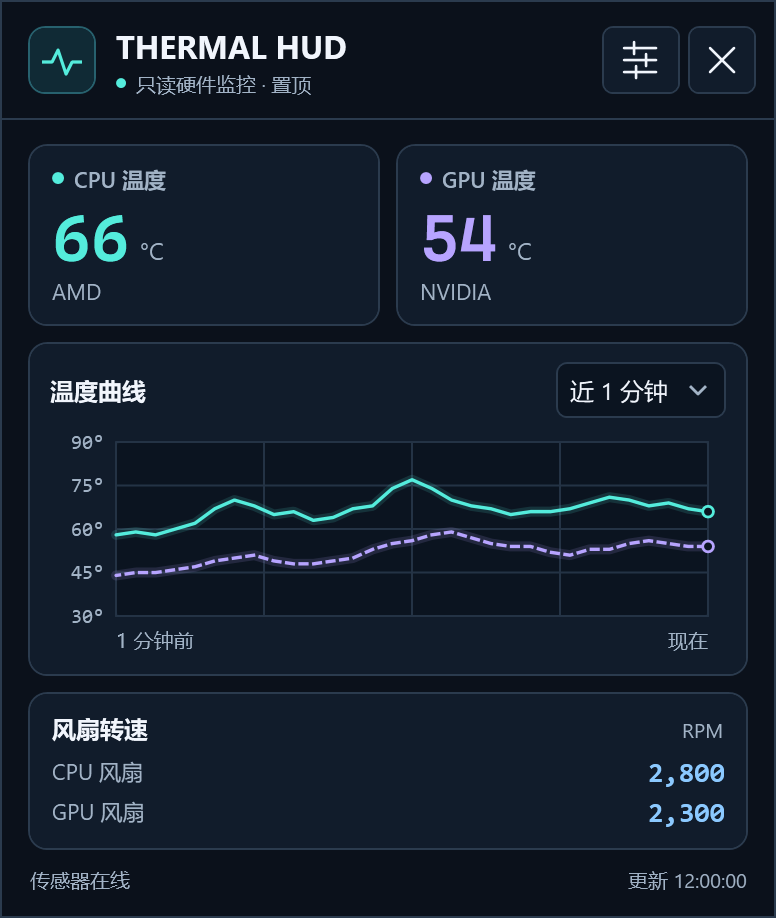

# Thermal HUD

Thermal HUD 是一个 Windows 硬件监控小窗。它在桌面右上角实时显示 CPU、GPU 温度和风扇转速，可按需置顶。温度卡片只显示硬件厂商，风扇转速以 RPM 显示。

**[下载 Windows x64 版](https://github.com/J2017LBH/thermal-hud/releases/latest/download/ThermalHud.exe)** · [查看发行说明](https://github.com/J2017LBH/thermal-hud/releases/latest)



## 下载与运行

1. 下载 `ThermalHud.exe`。这是一个 Windows x64 单文件程序，约 250 KiB。发行说明提供 SHA-256 校验值。
2. 若电脑尚未安装 .NET 10 桌面运行时，请选择 **.NET Desktop Runtime → Windows → x64**。[Microsoft 下载页](https://dotnet.microsoft.com/zh-cn/download/dotnet/10.0)
3. 双击运行 `ThermalHud.exe`。程序可在普通用户权限下运行。拖动小窗左上角的标题区域可以移动窗口。

## 使用

- **温度曲线**显示最近 1、5 或 15 分钟的数据。青色实线是 CPU，紫色虚线是 GPU。程序重启后，曲线从空白开始记录。
- **监控设置**位于右上角的滑杆图标中。可以调整采样间隔、告警阈值、提示音、置顶及登录自启动，点击 **保存** 生效。
- **告警**触发时，相应读数会高亮，窗口显示告警横幅。清空阈值可关闭对应的告警。部分设备在低负载时会正常停转，请按设备行为设置低转速阈值。

| 设置 | 默认值 |
| --- | --- |
| 采样间隔 | 2 秒，可选 5 或 10 秒 |
| CPU 高温告警 | 90 °C |
| GPU 高温告警 | 85 °C |
| 风扇低转速告警、提示音 | 关闭 |
| 始终置顶 | 开启 |
| 登录 Windows 后自动启动 | 关闭，可为当前账户开启 |

移动程序后，若已启用自启动，请在新位置打开程序并重新保存设置。删除程序前，可以先在设置里关闭自启动。

## 传感器支持

已在一台搭载 Intel CPU 和 NVIDIA GPU 的 ASUS ROG 笔记本上验证 CPU 温度、GPU 温度和两路风扇转速。其他机型的读数取决于驱动和硬件提供的接口，缺失的读数会标为不可用。

| 数据 | 读取途径 |
| --- | --- |
| CPU 温度和风扇 RPM | 通过已安装的 ASUS 系统控制接口读取固件数据，需机型暴露对应传感器。 |
| GPU 温度 | 优先通过 NVIDIA 驱动读取核心温度，也可使用 ASUS 固件提供的 GPU 温度。鼠标悬停在 GPU 数值上可查看当前来源。 |

程序只读取硬件状态，风扇控制和硬件配置由系统及厂商工具管理。历史采样留在内存中。设置保存到 `%LOCALAPPDATA%\ThermalHud\settings.json`，自启动仅登记在当前 Windows 账户下。运行时无需联网。

## 从源码构建

在 Windows 上安装 .NET 10 SDK，然后从仓库根目录执行以下命令。发布文件位于 `dist\ThermalHud.exe`。[Microsoft 下载页](https://dotnet.microsoft.com/zh-cn/download/dotnet/10.0)

```powershell
dotnet publish .\ThermalHud\ThermalHud.csproj -c Release -r win-x64 --self-contained false -p:PublishSingleFile=true -p:DebugType=None -o .\dist
```

## 技术参考

- ASUS 固件查询接口及传感器标识参考 G-Helper。[G-Helper 的 ASUS ACPI 接口](https://github.com/seerge/g-helper/blob/main/app/AsusACPI.cs)
- NVIDIA 核心温度通过驱动自带的 NVML 查询。[NVIDIA NVML 设备查询文档](https://docs.nvidia.com/deploy/nvml-api/latest/api/group__nvmlDeviceQueries.html)
